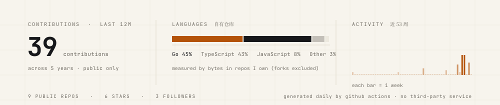

<picture>
  <source media="(prefers-color-scheme: dark) and (max-width: 640px)" srcset="assets/hero-mobile-dark.svg">
  <source media="(prefers-color-scheme: dark)" srcset="assets/hero-dark.svg">
  <source media="(max-width: 640px)" srcset="assets/hero-mobile-light.svg">
  
</picture>

 

> 我做本地优先的工具：**不改别人的安装包，不接管全局，随时能一键还原。**
>
> 「能用」很容易，我想做的是「敢装」——这是我所有项目共用的同一条底线。

<h3>现在 / NOW</h3>

- **wild-work** — 把 13 家 AI 客户端的账号聚合成一个 OpenAI 兼容端点；本地分支加了 React 面板、桌宠、运行统计与记账修正
- **dsh-rule-proxy** — 给 DSH 的网页工具做按域名分流的传输层，上游不可达时自动回退直连
- **aihot** — 「每个行业都可以有自己的 AIHOT」：自己找热点、自己写日报的资讯站框架

<h3>作品 / SELECTED WORK</h3>

- **[wild-work](https://github.com/xiaoyi728/wild-work)** — 十三家 AI 客户端的账号 → 一个 OpenAI 兼容端点；本地增强：React 面板、桌宠、运行统计、记账修正 &nbsp;·&nbsp; `Go` `React`
- **[aihot](https://github.com/xiaoyi728/aihot)** — 自己找热点、自己写日报的行业资讯站框架，信源与精选标准都可以换成你的 &nbsp;·&nbsp; `Node 24` `PostgreSQL` &nbsp;·&nbsp; [aihot.news](https://aihot.news)
- **[dsh-rule-proxy](https://github.com/xiaoyi728/dsh-rule-proxy)** — 按 hostname 规则分流 HTTP(S)，上游挂了自动直连；不碰模型请求、不接管全局代理 &nbsp;·&nbsp; `JavaScript` `RE2-WASM`
- **[zcode-skin](https://github.com/xiaoyi728/zcode-skin)** — ZCode 桌面端换肤：本地 CDP 注入，不动 `app.asar`、不改签名，应用自动更新后天然免疫 &nbsp;·&nbsp; `Electron`

另有若干 fork 里的本地适配：[clipboard-sync](https://github.com/xiaoyi728/clipboard-sync)（Rocky Linux 8）、[TrendRadar](https://github.com/xiaoyi728/TrendRadar)、[rea](https://github.com/xiaoyi728/rea)；以及一份 [DSH 插件精选](https://awesome-dsh-plugin.com)。

<h3>数据 / 自己算的</h3>

<picture>
  <source media="(prefers-color-scheme: dark) and (max-width: 640px)" srcset="assets/stats-mobile-dark.svg">
  <source media="(prefers-color-scheme: dark)" srcset="assets/stats-dark.svg">
  <source media="(max-width: 640px)" srcset="assets/stats-mobile-light.svg">
  
</picture>

<h3>规矩落进代码 / IN PRACTICE</h3>

- **`01` 不改包** —— 不做二进制补丁、不重打包签名：zcode-skin 走 CDP 注入，wild-work 用 `//go:embed` 把面板打进二进制。上游怎么升级，都砸不到自己。
- **`02` 不越界** —— 只接管被明确点名的那部分：dsh-rule-proxy 按 hostname 分流，碰不到模型请求、不改全局 fetch；没命中就走独立直连。
- **`03` 可还原** —— 每个开关都有反向操作：一键还原官方外观、干净卸载，不留注册表、不留环境变量、不留后台。

<h3>栈</h3>

`Go` · `TypeScript` · `React` · `Node` · `Docker` · `Linux`（Rocky / Ubuntu）· `PostgreSQL`

这个主页是怎么长出来的（可复刻）

 

- 图形全部是**手写 SVG**：`scripts/build_assets.py` 用 JetBrains Mono + 思源宋体把文字转成 path，所以任何系统上都不会跑版、不会变豆腐块，也不依赖任何第三方卡片服务
- 数据每天由 GitHub Actions 跑 `scripts/fetch_stats.py` 重新生成快照：贡献数、语言占比（只算自己拥有的仓库，排除 fork）、近 53 周活动，全部来自 GitHub 官方 API
- 想换配色：`python3 scripts/build_assets.py --palette mint`（另有 `vermilion`），然后 `--all-preview` 看全套预览
- 目录：`assets/` 成品 · `scripts/` 生成器 · `snapshot.json` 数据快照 · `.github/workflows/` 每天的活

xiaoyi728 · 2026 · 排版比装饰更耐看

